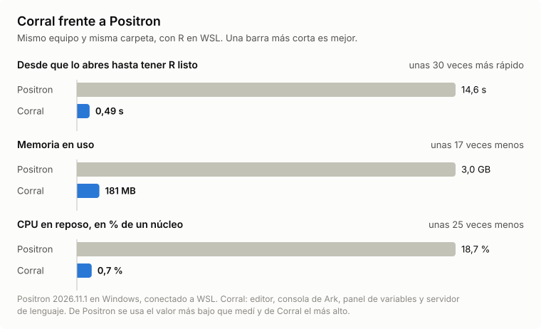
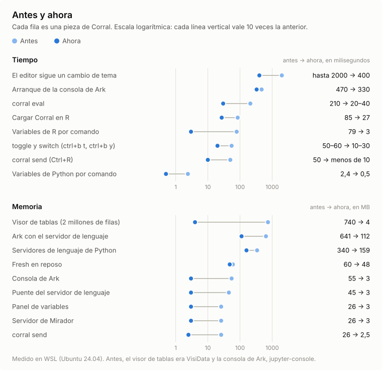

# Corral

Corral junta en la terminal lo que hoy obliga a abrir Positron: escribir un script de R o de Python y ejecutarlo por partes, ver los gráficos, revisar las variables y mirar una tabla, todo al lado de los agentes. Está pensado para WSL con [herdr](https://herdr.dev), aunque el comando `corral` funciona en cualquier terminal.

Todo ocurre dentro de herdr. Los visores aparecen encima de la terminal cuando los pides y se cierran con `q` o `Esc`, así que nada ocupa espacio mientras trabajas. Si quieres ver algo en grande, **Mirador** muestra lo mismo en el navegador.

Estado: versión 0.1.0, en uso diario en WSL con Warp. La consola de R es [Ark](https://github.com/posit-dev/ark), el kernel de R de Positron (o R normal, si lo prefieres), y la de Python es IPython en el entorno uv del proyecto.

## Piezas

| Carpeta | Qué es |
|---|---|
| `rs/` | El comando `corral`, en Rust y sin dependencias: todo Corral. El layout y sus paneles, enviar y ejecutar código, las consolas, el panel de variables, las tablas, la paleta, los gráficos, Mirador, el tema, la instalación y `doctor`. |
| `bin/corral-run` | Lo que ejecutan los atajos de herdr: el comando `corral`. |
| `herdr/` | Plugin de herdr: atajos, layout y popups. Solo llama a `corral`. |
| `r/corral.R` | Lado de R: registra la sesión, `View()` y gráficos con httpgd. |
| `py/` | Lado de Python: la sesión de IPython publica sus variables, sirve las figuras de matplotlib con la misma interfaz que httpgd y agrega `View()`. Corre dentro de tu IPython, así que es Python. |
| `mirador/` | La página de Mirador, la vista en el navegador (`index.html`); su servidor está en el `corral` de Rust. |
| `claude/skills/corral-r/` | Skill para Claude Code: le enseña a trabajar en tus consolas de R y Python con `corral eval`. |
| `fresh/` | Configuración y plugin del editor [Fresh](https://getfresh.dev) para escribir scripts de R y Python. |

Todo lo que tiene estado vive en un panel de herdr (las sesiones de R y Python, los agentes). Los visores se pueden cerrar sin perder nada, porque leen de esas sesiones cada vez que se abren.

## Instalación

```bash
curl -LsSf https://raw.githubusercontent.com/paulovillarroel/corral-term/main/install.sh | sh
```

Antes de cambiar nada, el instalador revisa lo que Corral necesita y muestra una lista con lo que está (✓), lo que falta (✗), lo que va a descargar (↓) y lo opcional (!). Si falta algo necesario, dice qué comando corre cada cosa, no toca nada y termina; con eso resuelto, se vuelve a correr la misma línea. No usa `sudo` y solo escribe dentro de tu carpeta personal.

| | |
|---|---|
| Necesario | Linux x86_64 o Windows con WSL, [herdr](https://herdr.dev) 0.9.5 o más nuevo, R con los paquetes `httpgd` y `jsonlite`, y [Rust](https://rustup.rs) (`cargo`) solo si el paquete no trae `corral` compilado, que es lo que pasa mientras no haya una versión publicada |
| Lo pone el instalador | `corral` ya compilado (o lo compila con `cargo`), y si te faltan, [Fresh](https://getfresh.dev) (el editor), [DuckDB](https://duckdb.org) (las tablas), [Air](https://posit-dev.github.io/air/) (el formato de R) y [Ark](https://github.com/posit-dev/ark) (la consola de R), todos en `~/.local` |
| Opcional | [uv](https://docs.astral.sh/uv/) para la consola de Python, Claude Code para la skill, y los paquetes de R `nanoparquet` y `rlang` |

Para ver la lista sin instalar nada:

```bash
curl -LsSf https://raw.githubusercontent.com/paulovillarroel/corral-term/main/install.sh | sh -s -- --revisar
```

Lo que cambia en tu equipo, siempre con una copia del archivo antes de tocarlo (`*.antes-de-corral-FECHA`):

- Corral queda en `~/.local/share/corral-term`, y el comando en `~/.local/bin/corral`.
- herdr: enlaza el plugin de Corral y agrega sus atajos al final de `~/.config/herdr/config.toml`, entre dos comentarios de Corral. Si ya usas una de esas teclas, la deja como está y lo avisa.
- R: una línea en `~/.Rprofile` que carga Corral. Solo se activa en las consolas que abre Corral; el resto de tus sesiones de R no cambia.
- Fresh: agrega a tu `~/.config/fresh/config.json` los atajos y los servidores de lenguaje de Corral, sin borrar tus ajustes, y enlaza su plugin.
- Claude Code: enlaza la skill de Corral en `~/.claude/skills/corral-r`.

Para actualizar, vuelve a correr la misma línea: reemplaza la copia de Corral y no repite nada de lo que ya estaba. `corral instalar` revisa y repara la instalación sin descargar nada, y `corral instalar --revisar` solo revisa.

Desde una copia del repositorio, el instalador usa esa copia donde está, sin descargarla. Es la forma de instalarlo mientras el repositorio sea privado, porque la línea de `curl` necesita que sea público:

```bash
git clone https://github.com/paulovillarroel/corral-term.git
sh corral-term/install.sh
```

En macOS todavía no funciona. herdr sí corre en Mac, pero algunas piezas de Corral usan funciones propias de Linux (ver [Límites conocidos](#límites-conocidos)).

### Desinstalar

```bash
corral desinstalar
```

Quita el plugin y los atajos de herdr, la línea de `~/.Rprofile`, los atajos, el tema y los servidores de lenguaje de Corral en el editor (y te devuelve los atajos tuyos que había reemplazado), la skill, los programas que descargó y la copia de Corral. Una copia clonada del repositorio no la borra. Tus ajustes y sesiones quedan en `~/.config/corral` y `~/.local/state/corral`, por si vuelves.

### Publicar una versión

El instalador descarga el paquete de la última versión publicada en GitHub, que trae `corral` ya compilado para que nadie necesite Rust. Lo arma la acción [`.github/workflows/version.yml`](.github/workflows/version.yml) al subir una etiqueta:

```bash
git tag v0.1.0 && git push origin v0.1.0
```

Sin ninguna versión publicada, el instalador descarga el código de `main` y compila `corral` con `cargo`. Si no hay `cargo`, se detiene antes de cambiar nada y da el comando para instalar Rust.

### Salir de Corral

`ctrl+b shift+c` cierra el script, la consola y las variables (también el que esté oculto por `ctrl+b t`), y deja la pestaña con Claude, como cualquier pestaña de herdr. Cerrar la consola termina esa sesión de R. El borrador sin guardar se descarta. Mirador sigue abierto hasta que cierres su ventana; `corral mirador --stop` detiene su servidor.

## Cuándo actúa Corral

Corral no cambia nada mientras no lo pidas:

- **En R** solo se activa en la consola que abre `ctrl+b a` (que arranca R con `CORRAL=1`), o en un R donde tú lo actives: `ctrl+b m` en ese panel, o `corral_activar()` en la consola. Cualquier otro R funciona como siempre, con su `View()` y su dispositivo gráfico. Para activarlo en todos los R, agrega `options(corral.always = TRUE)` a tu `.Rprofile` antes de la línea de Corral.
- **El layout** (script, consola y variables) solo aparece con `ctrl+b a`.
- **Los atajos `ctrl+b`** solo hacen algo cuando los usas.
- **Claude** usa tu consola solo si el workspace tiene una consola de Corral activa. Si no, trabaja como siempre.

## Uso

Los atajos empiezan con `ctrl+b`: apriétalo, suéltalo y después la otra tecla.

| Quieres | Haces |
|---|---|
| Abrir el espacio de trabajo | `ctrl+b a`. Crea una pestaña con Claude Code a la izquierda (52 % del ancho) y, a la derecha, el script, la consola de R y las variables (el script y la consola se reparten el 73 % del alto, 57/43, y las variables el 27 % restante). El editor abre con el explorador de carpetas a la vista. Con `corral layout --shell` agrega una shell junto a las variables; `--ratio` cambia el ancho de Claude. Para trabajar en el código, `ctrl+b shift+a` abre el layout con foco en el código: los mismos paneles con el script a la izquierda y Claude arriba a la derecha, sobre la consola (`corral layout --foco codigo`). Los dos están en la paleta (`ctrl+b space`), en el grupo «Layouts». |
| Expandir el script o la consola | `ctrl+b t` expande el panel donde estás (script o consola; en el layout con foco en el código, Claude o la consola) a toda la zona que comparten, sobre las variables. Otra vez `ctrl+b t` y vuelven los dos, con la misma proporción. herdr no achica un panel a menos del 10 %, así que el otro pasa a una pestaña propia, "consola (oculta)" o "script (oculto)", donde sigue corriendo: Ctrl+R y Claude siguen ejecutando en la consola aunque no la veas. También `corral toggle script\|consola\|ambos` (`agente` en vez de `script` en el layout con foco en el código). En un layout que ya tenías: `corral script`. |
| Ver tus objetos y gráficos mientras trabajas | El panel de variables se actualiza después de cada comando, tuyo o de Claude, y sigue a la consola aunque reinicies R. Lista tus objetos, incluidos los gráficos guardados en variables (`ggplot`, `lattice`, `patchwork`). Enter sobre un data frame abre la tabla; sobre un objeto gráfico lo dibuja y lo abre en Mirador; sobre otro objeto corre `str()`. El historial de dibujos no aparece aquí: está en Mirador (`ctrl+b f`). En un layout que ya tenías: `corral vars --split`. |
| Correr código en R | Selecciona texto con el mouse en cualquier panel (por ejemplo, código que escribió Claude); herdr lo copia solo. Después `ctrl+b enter`. Si no hay selección, se envía lo que tengas en el portapapeles. |
| Ver los gráficos | El primer gráfico de cada sesión abre Mirador solo, como ventana normal a la derecha de la pantalla y al frente. Después se actualiza sin robarte el foco. `ctrl+b f` lo trae al frente en el último gráfico. En una terminal que dibuje imágenes (ver abajo), `ctrl+b f` muestra el gráfico dentro de herdr. |
| Ver las variables en grande | `ctrl+b d` las abre encima de la terminal. |
| Moverte en el panel de variables | Pestañas Datos, Gráficos, Valores, Funciones y Otros: ←/→, `Tab` o las teclas 1 a 5, o un clic. `/` busca. Un objeto gráfico que ya está dibujado se abre sin volver a dibujarlo. |
| Ver una tabla | `View(df)` en R o en Python. Se abre encima de la terminal en el visor de Corral, que consulta DuckDB; `q` la cierra. |
| Usar otra consola de R | En ese panel, `ctrl+b m`: la marca como consola y, si hay un R abierto, activa Corral en él. |
| Abrir Mirador | `ctrl+b shift+m`, o `corral mirador`. |
| Abrir `quarto preview` | `ctrl+click` sobre la URL `http://localhost:...` en herdr. |

### Atajos de herdr

`ctrl+b space` abre la paleta de Corral: todos sus atajos en una lista con búsqueda (los de herdr, el editor, la consola, el panel de variables, las tablas y Mirador). Escribe parte de lo que buscas (`grafico`, `python`, `copiar`); Enter ejecuta las acciones, y Esc cierra. La lista sale de tu configuración, así que muestra tus atajos aunque los hayas cambiado. También está en el editor (`Ctrl+P`, "Corral: atajos de teclado") y en Mirador (`?`).

| Atajo | Acción |
|---|---|
| `ctrl+b space` | Paleta de atajos y acciones de Corral |
| `ctrl+b a` | Layout con foco en el agente: Claude a la izquierda, el script sobre la consola a la derecha |
| `ctrl+b shift+a` | Layout con foco en el código: el script a la izquierda, Claude sobre la consola a la derecha |
| `ctrl+b shift+c` | Cerrar Corral: cierra script, consola y variables, y deja a Claude como panel normal |
| `ctrl+b t` | Expandir el script o la consola (el panel donde estás); otra vez, ambos |
| `ctrl+b y` | La consola pasa de R a Python, o de Python a R (Python se abre la primera vez) |
| `ctrl+b enter` | Enviar la selección o el portapapeles a la consola que se ve (R o Python) |
| `ctrl+b f` | Ver el último gráfico en Mirador |
| `ctrl+b d` | Ver las variables encima de la terminal |
| `ctrl+b m` | Usar este panel como consola (R o IPython, según lo que corre) y activar Corral en él |
| `ctrl+b shift+m` | Abrir Mirador |

### Comandos

| Comando | Qué hace |
|---|---|
| `corral layout` | Abre el espacio de trabajo (`--foco codigo` con el script a la izquierda y Claude sobre la consola, `--shell` agrega una shell, `--editor ''` sin script, `--agent ''` sin Claude). |
| `corral close` | Cierra los paneles de Corral de la pestaña (script, consola, variables) y deja el resto, Claude incluido. La sesión de R se cierra con su panel. |
| `corral script [archivo]` | Agrega el editor sobre la consola en un layout existente. `--leer` muestra el borrador actual, con lo que no has guardado; `--guardar ruta.R` lo guarda (con `--forzar` reemplaza); `--escribir` agrega al final el texto que recibe por stdin (con `--reemplazar`, reemplaza todo), como una sola edición que `Ctrl+Z` deshace. |
| `corral atajos` | La paleta de atajos (`ctrl+b space`). `--lista` la imprime y `--json` la entrega para agentes; `--cambiar ID TECLA` cambia un atajo de herdr (`corral atajos --cambiar herdr:toggle shift+e`) o del editor (`editor:corral_run_line ctrl+e`), y rechaza teclas que ya están en uso salvo con `--forzar`. Claude puede leerlos y cambiarlos si se lo pides. |
| `corral toggle [script\|agente\|consola\|ambos]` | Expande el script o la consola, o vuelve a mostrar ambos; sin argumento, expande el panel donde estás o vuelve a ambos. |
| `corral switch [r\|python]` | La consola del layout pasa a R o a Python; sin argumento, alterna. La otra sigue corriendo en la pestaña "corral (oculto)". |
| `corral console` | Marca el panel actual como consola de R o de Python (según lo que corre en él) y activa Corral si hay un R o un IPython abierto. |
| `corral send 'código'` | Envía código a la consola que se ve, o a la de `--lang r\|python`. También lee stdin, la selección o el portapapeles; `--source` lo ejecuta como archivo (`source()` en R, `%run -i` en Python). |
| `corral eval 'código'` | Ejecuta en la consola y devuelve la salida (pensado para agentes); R por defecto, `--lang python` para Python. `--file`, `--timeout`, `--check`; `--reemplazar` hace que sus gráficos reemplacen a los de la petición anterior. |
| `corral vars` | Variables de la consola que se ve, encima de la terminal; `--split` abre el panel fijo, `--json` las imprime (`--lang` elige R o Python). |
| `corral plots` | Último gráfico (en Mirador en Windows). |
| `corral view archivo` | Abre una tabla (parquet, csv, json) en el visor de tablas. |
| `corral mirador` | Abre Mirador; `--stop` lo detiene, `--url` muestra la dirección. |
| `corral open [url]` | Abre una URL local en el navegador. |
| `corral theme` | Aplica el tema de herdr al editor, los visores, VisiData y Mirador (`--mostrar` solo enseña la paleta). |
| `corral config [clave] [valor]` | Lee o cambia la configuración: `images`, `mirador_window`, `mirador_size`, `python_console`, `r_console` (`ark`, `r` o un comando propio). |
| `corral ark` | Muestra si la consola de R usa Ark; `--instalar [versión]` descarga Ark (por defecto 0.1.252, la versión probada). |
| `corral doctor` | Revisa dependencias, plugin, Mirador y qué terminal detecta. |

### El script

El panel de script es [Fresh](https://getfresh.dev), un editor de terminal sin modos, con los atajos de VS Code (y por lo tanto casi los de Positron), menús y mouse. Para R tiene:

- **Autocompletado** en un menú que aparece solo mientras escribes; ayuda al pasar sobre una función y la firma al abrir el paréntesis; ir a la definición. Con Ark lo da el mismo R de la consola, así que conoce tu sesión: `autos$` ofrece las columnas de tu `autos`. Con R normal lo da el paquete `languageserver`, que solo ve el texto de los archivos.
- **Diagnósticos** como en Positron, solo problemas reales. Con Ark son los de Ark (errores de sintaxis, sobre todo). Con R normal son las reglas *correctness* de lintr (un objeto que no existe, `x == NA`, un argumento repetido), o el `.lintr` del proyecto si tiene uno. En los dos casos el estilo no se marca, porque Air lo arregla al guardar. Fresh arranca el servidor con `corral _lsp`, que elige según la consola.
- **Indentación mientras escribes**, igual que la deja Air: un nivel dentro de un paréntesis abierto, un nivel para las líneas que siguen a `|>`, `%>%`, `+` u otro operador, y de vuelta al margen cuando la instrucción termina.
- **Formato con Air** cada vez que guardas (`Ctrl+S`).

Atajos de Corral. Desde Warp, a través de herdr, solo llegan bien `Ctrl+letra` y las teclas de función: `Ctrl+Enter` llega como `Enter` y los atajos con `Alt` se cortan. Por eso cada acción tiene un atajo que funciona ahí y, entre paréntesis, el de Positron para terminales que sí lo envían.

| Atajo | Qué hace |
|---|---|
| `Ctrl+R` (`Ctrl+Enter`) | Ejecuta la selección o, si no hay, la instrucción completa bajo el cursor (incluidas cadenas de `\|>` o `+` de varias líneas) y avanza a la siguiente. |
| `F5` (`Ctrl+Shift+Enter`) | Ejecuta el archivo completo con `source(echo = TRUE)`. |
| `Ctrl+L` (`Alt+-`) | Inserta ` <- `. |
| `Ctrl+U` (`Ctrl+Shift+M`) | Inserta ` \|> `. |
| `Ctrl+/` | Comenta o descomenta. |
| `Ctrl+Space` | Autocompletado. También aparece solo mientras escribes. |
| `Ctrl+S` | Guarda y formatea con Air. En el borrador temporal, pregunta dónde guardarlo. |

**El borrador es temporal.** Cada `ctrl+b a` abre un `borrador.R` nuevo y vacío dentro del proyecto, en `.corral/<workspace>-<fecha>/`. Así Air, lintr y el servidor de lenguaje usan la configuración del proyecto (`air.toml`, `.lintr`, `DESCRIPTION`, `renv.lock`). Corral crea `.corral/.gitignore` con `*`, de modo que git no ve esos archivos y no hace falta tocar tu `.gitignore`. El explorador de archivos no muestra `.corral/` porque empieza con punto. El borrador se borra al cerrar el editor, el panel o el layout; lo que quieras conservar lo guardas en el proyecto con `Ctrl+S`. Si algo cierra el editor de golpe, el borrador abandonado se borra la próxima vez que abras un layout en ese proyecto. Un archivo que guardaste a mano dentro de la carpeta del borrador se conserva, y esa carpeta se borra a los dos días. Si abres el layout en tu carpeta personal o en una carpeta sin permiso de escritura, el borrador va a `$XDG_RUNTIME_DIR/corral/borradores/`, que WSL vacía al reiniciar.

Se pierde al cerrar el layout, salvo que lo guardes:

- `Ctrl+S` en el borrador pide un nombre y lo guarda en el proyecto (la carpeta donde abriste el layout). Puedes escribir `analisis/modelo` o una ruta completa; si falta la extensión, agrega `.R`, y si el archivo existe, pregunta antes de reemplazarlo. Desde ahí el editor sigue con el archivo nuevo. En cualquier otro archivo, `Ctrl+S` guarda normal.
- *Archivo → Guardar como* parte en la carpeta del borrador, que no se puede cambiar. Si guardas ahí con otro nombre, Corral mueve el archivo al proyecto con ese nombre (si ya existe uno igual, lo deja y te avisa).
- O pídeselo a Claude: usa `corral script --guardar ruta.R`, que guarda también lo que no has guardado. `corral script --leer` muestra el contenido actual.

El borrador es un archivo real, y no un "sin nombre", porque el autocompletado solo funciona en archivos guardados. Los archivos nuevos sin nombre se abren como R, pero sin autocompletado hasta que los guardes.

Cada editor lee la configuración y los plugins al abrirse. Si cambias `config.json` o el plugin, cierra el editor con `Ctrl+Q` y vuelve a abrirlo (o vuelve a abrir el layout con `ctrl+b a`).

La configuración está en [`fresh/config.json`](fresh/config.json) y el plugin en [`fresh/plugins/corral.ts`](fresh/plugins/corral.ts). Fresh viene con las búsquedas de actualizaciones y la telemetría desactivadas (`check_for_updates: false`).

### Rendimiento

#### Frente a Positron

<picture>
  <source media="(prefers-color-scheme: dark)" srcset="docs/graficos/positron-oscuro.svg">
  
</picture>

Medido el 21 de noviembre de 2026 en el mismo equipo, con la carpeta `test-codigo` y R en WSL, dos veces cada uno. Positron es la versión 2026.11.1 en Windows, conectada a WSL; Corral es un layout completo (editor, consola de Ark, panel de variables y servidor de lenguaje). En el gráfico, de Positron se usa el valor más bajo que medí y de Corral el más alto.

| Qué | Positron | Corral |
|---|---|---|
| Desde que lo abres hasta tener R listo | 11,4–17,0 s | 0,48–0,51 s |
| Memoria en uso | 2,9–3,2 GB (1,2–1,6 GB en Windows y 1,6–1,7 GB en WSL) | 164–165 MB |
| CPU en reposo | 16–21 % de un núcleo (12,5–17,3 % en Windows y 3,4–3,8 % en WSL) | 0,3–0,4 % |
| R (Ark) | 117 MB | 104–106 MB |
| De Ctrl+R a ver el resultado | sin medir | 9–17 ms |

R pesa lo mismo en los dos, porque ambos usan Ark. La diferencia es la interfaz: en WSL, el proceso de extensiones de Positron ocupa 674–711 MB, su servidor 276–289 MB y Copilot 241 MB, y la ventana de Windows suma otros 1,2–1,6 GB. En una medición anterior Positron también arrancó Python con su servidor de lenguaje (unos 440 MB), porque la carpeta tiene `pyproject.toml`; Corral abre Python solo cuando lo usas. Para Corral no cuento herdr ni la terminal, que están abiertos de todos modos para Claude. El tiempo de ejecución dentro de Positron no lo medí, porque habría que manejar su interfaz con clics. El tiempo de Positron incluye entre 0,7 y 2,2 s que tarda PowerShell en lanzarlo, y su CPU se midió entre 30 y 60 s después de abrirlo, cuando puede que todavía no se hubiera asentado.

Una medición anterior del mismo día, antes de optimizar Fresh, la carga de R y los servidores de lenguaje, daba para Corral 181 MB y 0,7 % de CPU en reposo.

#### corral en Rust

<picture>
  <source media="(prefers-color-scheme: dark)" srcset="docs/graficos/mejoras-oscuro.svg">
  
</picture>

Los motores ya están en Rust: herdr, Fresh, Ark, Air, Ruff y uv. Corral entero es un solo binario de `rs/`, sin dependencias. Primero pasaron a Rust lo que corre a cada tecla, lo que usa Claude y los procesos que quedan abiertos; estas son las mejoras de esa etapa:

| Pieza | Rust | Antes, en Python |
|---|---|---|
| `corral send` (Ctrl+R, F5, `ctrl+b enter`) | menos de 10 ms, 2,5 MB | unos 50 ms, 26 MB |
| `toggle` y `switch` (`ctrl+b t`, `ctrl+b y`) | 10–30 ms | 50–60 ms |
| Panel de variables (`corral vars --pane`) | 3 MB, 0,1 % de CPU | 26 MB |
| Puente del servidor de lenguaje de Ark (`corral _lsp r`) | 3 MB | 45 MB |
| Servidor de Mirador (`corral _mirador`) | 3 MB | 26 MB |
| `corral eval` (Claude ejecuta código en tu consola) | 20–40 ms | unos 210 ms |
| Consola de Ark (`corral _console r`) | 3 MB, arranca en 0,33 s | `jupyter-console`: 55 MB, 0,47 s |

También bajó lo que se repite después de cada comando y lo que queda corriendo en el editor:

| Qué | Antes | Ahora |
|---|---|---|
| Variables de R después de cada comando | 79 ms | 3 ms, o 4 ms si cambió una variable |
| Variables de Python después de cada comando | 2,4 ms | 0,4–0,6 ms |
| Plugin de Fresh en reposo (CPU del editor) | 1,0 % | 0,56 % |
| El editor sigue un cambio de tema de herdr | hasta 2 s | 0,4 s |
| Fresh en reposo, con los plugins que no usa desactivados | 60 MB, 0,57 % de CPU | 48 MB, 0,20 % |
| Cargar Corral en R (`corral.R`) | 85 ms, 23 MB | 27 ms, 17 MB |
| Servidores de lenguaje de Python | 340 MB (pylsp y Ruff) | 159 MB (ty y Ruff) |
| Mirador muestra un gráfico nuevo | 0 a 1,5 s (preguntaba cada 1,5 s) | unos 80 ms |
| Gráfico de 100 mil puntos en Mirador | SVG de 7,1 MB | PNG de 0,7 MB |

Durante el uso, cada comando en la consola de R tarda unos 2,5 ms de Enter al siguiente prompt (1,5 ms sin Corral), también con una tabla de 2 millones de celdas en memoria; en Python, unos 6 ms con o sin Corral.

`corral.R` ya no carga paquetes que no necesita al arrancar: httpgd (con unigd, systemfonts, lifecycle y cli) se carga con el primer gráfico, y la firma de cada variable usa la dirección en memoria que da R base, sin rlang (que tardaba 54 ms en cargarse). El servidor de Python y Ruff corren directo desde el entorno que uv guarda en su caché para ellos (`corral _lsp python`, `corral _lsp ruff`): con `uvx` o `uv run`, uv se quedaba esperando como proceso padre todo el tiempo, unos 45 MB por cada uno. El servidor de Python pasó de pylsp a ty: en la misma prueba con pandas, ty usa 141 MB en un proceso (pylsp, 172 MB en dos), arranca en milisegundos (pylsp, medio segundo), completa en la mitad del tiempo y muestra la ayuda en 2 ms, con la documentación completa (pylsp tardaba 0,3–0,4 s y solo mostraba la firma). La consola de Python sigue con `uv run`, porque IPython tiene que correr dentro del entorno del proyecto.

Las variables se describen de nuevo solo si el objeto cambió (otra dirección en memoria, otro largo, otras dimensiones o, en las tablas, otros tipos de columna), y el archivo que lee el panel se reescribe solo cuando algo cambió. El plugin de Fresh ya no revisa nada a intervalos: copia el borrador cuando dejas de escribir 0,4 s (al menos cada 2 s si sigues escribiendo), vigila los archivos de tema con el sistema de archivos y abre la vista de carpetas cuando aparece un borrador. Fresh trae unos 50 plugins; Corral desactiva en `fresh/config.json` los que no usa (orquestación de agentes, que ya hace herdr, pantallas de bienvenida, Kubernetes, devcontainers y lenguajes como C# o C++). Con eso Fresh abre con 48 MB en vez de 60 y en reposo usa 0,20 % de CPU en vez de 0,57 %. Revisar cada 2 s si cambiaron los archivos abiertos (por ejemplo, cuando Claude los edita) cuesta tan poco que no se nota al medirlo, así que se mantiene.

El binario habla con herdr por su socket y con Ark por el protocolo de Jupyter (ZeroMQ y firmas HMAC-SHA256, implementados en `rs/src/zmtp.rs` y `rs/src/sha256.rs`). Lo demás también está en el binario: lee la configuración de herdr con su propio lector de TOML, descomprime Ark (que se publica en zip), Fresh, DuckDB y Air con su propio descompresor, y escribe el tema del editor y la paleta. Lo único que no es Rust corre dentro de tus sesiones: `r/corral.R` en R y `py/` en IPython.

Si cambias algo en `rs/`, vuelve a compilar con `cargo build --release`; `corral --version` dice de qué carpeta viene el binario que estás usando.

### Tablas

`View(df)` (en R o en Python), Enter sobre un data frame en el panel de variables, o `corral view archivo` abren la tabla encima de la terminal, en un visor que consulta el archivo con DuckDB. La sesión guarda la tabla como parquet y el visor le pide a DuckDB solo lo que está en pantalla: una página de filas, el conteo, el orden o la búsqueda son consultas de unos milisegundos. Con una tabla de 2 millones de filas abre al instante y usa unos 4 MB; VisiData tardaba 20 segundos y 740 MB en abrirla.

| Tecla | Acción |
|---|---|
| `↑` `↓`, `PgUp` `PgDn`, `g` `G` | Moverse por las filas (rueda del mouse también) |
| `←` `→`, `0` `$` | Moverse por las columnas; con el mouse, la rueda horizontal, deslizar de lado en el trackpad o Shift + rueda |
| `s` (o clic en el encabezado) | Ordenar por la columna: ascendente, descendente, sin orden |
| `/` | Buscar un texto en todas las columnas; `/` y Enter vacío quita la búsqueda |
| `f` | Filtrar con una condición; parte con el nombre de la columna actual. Acepta R (`mpg > 20 & cyl == 6`, `region %in% c("a", "b")`, `!is.na(x)`) o SQL de DuckDB (`region LIKE 'nor%'`) |
| `=` | Dejar solo las filas con el valor de la celda seleccionada |
| `x` | Quitar todos los filtros y la búsqueda |
| Enter | Ver la fila completa |
| `i` | Resumen de cada columna (`SUMMARIZE` de DuckDB) |
| `q` | Cerrar |

Los filtros se suman entre sí y con la búsqueda, y la línea de arriba dice cuáles están activos y cuántas filas quedan. Si un filtro tiene un error, no se aplica y DuckDB explica por qué. Mirador muestra las mismas tablas en el navegador, con la misma consulta a DuckDB. Si prefieres VisiData: `corral config table_viewer visidata`.

### La consola de R: Ark

Cuando Ark está instalado, la consola de R es Ark, el kernel de R de Positron. Corral lo lanza y le habla directamente por el protocolo de Jupyter, con su propia consola en Rust (3 MB). Se ve así:

- El prompt es `In [1]:`, y `...:` en las líneas que siguen. El código de Ctrl+R llega como un bloque pegado y se ve completo en el prompt.
- Enter ejecuta cuando la expresión está completa; si falta cerrar un paréntesis o una llave, pasa a la línea siguiente con sangría. `Alt+Enter` ejecuta de todos modos.
- `↑` `↓` recorren el historial (si ya escribiste algo, solo las entradas que empiezan igual); el historial se guarda en `~/.local/state/corral/historial-r.jsonl`. `Tab` completa con el autocompletado de R (funciones, argumentos, columnas con `$`, paquetes).
- `Ctrl+C` interrumpe lo que está corriendo, o borra lo escrito; `Ctrl+D` en una línea vacía cierra la consola, igual que `q()`. También funcionan `Ctrl+A` `Ctrl+E` `Ctrl+K` `Ctrl+U` `Ctrl+W` `Ctrl+L`.
- `readline()` y `menu()` preguntan en la consola, como en R.
- `?mean` o `help(mean)` abren la ayuda en una ventana del navegador, como el panel de ayuda de Positron.
- Variables, gráficos en Mirador, `View()`, `corral eval` y el resto de Corral funcionan igual que con R normal. Ark cambia algunas opciones de R para Positron (dispositivo gráfico, navegador, editor); `corral.R` las protege con `ark.protected_options` para que sigan siendo las de Corral.

La ganancia está en el editor y en los recursos. El autocompletado sale del mismo R de la consola, así que no hace falta un segundo R para el servidor de lenguaje. Medido con los mismos paquetes cargados (dplyr y ggplot2) y un gráfico: Ark ocupa unos 330 MB con el servidor de lenguaje incluido, más unos 6 MB de la consola y el puente, frente a unos 250 MB de R normal más unos 450 MB de `languageserver`. En reposo, Ark usa 0,1 % de CPU y `languageserver` 3 %.

El servidor de lenguaje lee todos los archivos de R de la carpeta del proyecto, que Fresh busca subiendo desde el archivo abierto hasta encontrar `.corral`, `.git`, `DESCRIPTION`, `renv.lock` u otro marcador. Antes uno de esos marcadores era `.Rprofile`, y en un proyecto sin `.git` la búsqueda llegaba hasta tu `~/.Rprofile`: Ark leía todo tu home y pasaba de unos 110 MB a más de 600 MB.

Para volver a R normal, `corral config r_console r`; para volver a Ark, `corral config r_console ark`. El cambio rige para las consolas que abras después. `corral ark` muestra qué está instalado. Para usar Ark con `jupyter-console` en vez de la consola de Corral, `corral config ark_frontend jupyter` (y `corral config ark_frontend corral` para volver).

### Python

R es la consola por defecto. En un proyecto con R y Python no hay que elegir al empezar: la consola cambia según lo que ejecutas.

- Ctrl+R o F5 en un archivo `.py` muestran la consola de Python en el lugar de la de R. La primera vez la abren: IPython con `uv run --with ipython` en la carpeta del proyecto, así que usa el entorno del proyecto (su `.venv` y sus paquetes) sin agregarle IPython. Si la carpeta no es un proyecto de uv, uv usa el `.venv` que encuentre o un Python propio.
- Ctrl+R o F5 en un archivo `.R` vuelven a R. `ctrl+b y` cambia a mano.
- La consola que no se ve sigue corriendo en la pestaña "corral (oculto)", con sus variables. Si entras a esa pestaña puedes usarla igual.
- El panel de variables, Mirador y `View()` siguen a la consola que se ve. El encabezado del panel dice "R 4.6.1" o "Python 3.14.3".

En Python, Ctrl+R envía la instrucción completa bajo el cursor: una función con todo su cuerpo (aunque tenga líneas en blanco), un `if` con su `else`, una llamada repartida en varias líneas o una función con decoradores. El código llega a IPython como un bloque pegado, igual que en Positron, y se ve en `In [n]:`. Una selección se envía sin su sangría común. F5 ejecuta el archivo con `%run -i`, que deja las variables en la sesión. Ctrl+L y Ctrl+U (`<-`, `|>`) no hacen nada en un `.py`.

Las figuras de matplotlib (y de seaborn o plotnine, que dibujan con matplotlib) van a Mirador al terminar cada ejecución, como en Jupyter; `plt.show()` las envía en ese momento. Una figura guardada en una variable aparece en la pestaña Gráficos del panel de variables, y Enter la muestra. Enter sobre un DataFrame de pandas o polars lo abre en el visor de tablas, y `View(df)` en la consola hace lo mismo.

En el editor, el autocompletado, la ayuda y el salto a la definición vienen de ty, que lee el `.venv` del proyecto y por eso conoce tus paquetes. ty todavía es una versión 0.0; si algo falla, `corral config python_lsp pylsp` vuelve a python-lsp-server, y `corral config python_lsp ty` a ty (rige al reabrir el editor). ty también sabe revisar tipos, pero en Corral esos diagnósticos están apagados para no repetir los de Ruff. Los diagnósticos son de Ruff con sus reglas por defecto (errores reales: nombres sin definir, imports sin usar, errores de sintaxis), y Ruff formatea al guardar, igual que Air en R. Si el proyecto tiene configuración de Ruff en `pyproject.toml` o `ruff.toml`, se usa esa.

Para usar otro comando en la consola de Python (por ejemplo, con más paquetes), `corral config python_console 'CORRAL=1 uv run --with ipython --with polars ipython --no-banner -i ~/.local/share/corral-term/py/startup.py'`.

### Claude en tus consolas de R y Python

Con la skill `corral-r`, Claude Code ejecuta su código en tu consola en vez de abrir un R o un Python aparte. Para Python agrega `--lang python`; si la consola de Python no existe, la abre. Ves cada comando aparecer en `corral:r` con una línea `# corral eval`, y los objetos, gráficos y tablas quedan en tu sesión. Claude recibe la salida y, si hizo un gráfico, una copia en PNG que puede mirar.

Lo mismo sirve desde cualquier terminal o script:

```bash
corral eval 'summary(mtcars)'
corral eval --file analisis.R
corral eval --lang python 'df.describe()'
corral vars --json
```

Si la consola está ocupada, `corral eval` espera hasta 20 segundos (`--wait-idle`). Si tienes una línea a medio escribir, no ejecuta nada y avisa. Varios agentes pueden usar la misma consola: sus peticiones se ejecutan una a la vez.

Claude mira cada gráfico que dibuja (Corral lo guarda como PNG) y a veces lo corrige: mueve etiquetas, cambia una escala. Para que no te queden versiones casi iguales en Mirador, la corrección va con `corral eval --reemplazar` y reemplaza al borrador. Si le pides un gráfico distinto, o quieres comparar versiones, se suma al historial como siempre.

### Gráficos en la terminal

En Windows, los gráficos no se pueden ver nítidos dentro de herdr. herdr solo deja pasar imágenes con el protocolo de Kitty, y las terminales nativas de Windows (Warp, WezTerm, Windows Terminal) se conectan con WSL a través de ConPTY, que descarta esas secuencias. Lo probamos: WezTerm en Windows no dibujó ni Kitty ni Sixel. Por eso en Windows los gráficos van a Mirador.

En Linux o macOS, con una terminal que dibuje Kitty (kitty, WezTerm, Ghostty), `ctrl+b f` muestra los gráficos dentro de herdr. Corral detecta en qué terminal está abierta cada ventana de herdr (`corral doctor` lo muestra); para forzarlo, `corral config images kitty`. [`wezterm/wezterm.lua`](wezterm/wezterm.lua) queda como referencia de configuración para WezTerm con WSL.

## Colores

herdr manda: Corral lee el tema de `~/.config/herdr/config.toml` (`[theme] name` y los colores de `[theme.custom]`) y lo aplica a todo lo demás:

- **Fresh** usa el tema `corral` (`~/.config/fresh/themes/corral.json`), con el fondo de la terminal para que el editor se vea igual que los otros paneles.
- **El panel de variables y los visores** usan el acento y los grises del tema.
- **VisiData** toma los mismos colores, aproximados a la paleta de 256 colores de la terminal.
- **Mirador** recibe la paleta como variables CSS.

Los cambios se siguen en vivo: si cambias el tema de herdr (o sus colores en `config.toml`), en unos segundos el editor, el panel de variables y Mirador se recolorean solos, sin reiniciar nada. VisiData toma los colores nuevos la próxima vez que abres una tabla. `corral theme` fuerza la actualización. herdr no publica los valores de sus colores, así que Corral usa los colores publicados de cada tema (vesper, catppuccin, dracula, tokyo-night, nord, gruvbox, one-dark, solarized, kanagawa, rose-pine) más tus ajustes de `[theme.custom]`.

### Temas propios de Corral

herdr no permite instalar temas, pero Corral trae los suyos, con colores de interfaz y de sintaxis exactos. Por ahora, `dark-2026`: el tema oscuro nuevo de VS Code (Dark 2026), el mismo de Positron.

```bash
corral config tema dark-2026     # el editor, la consola, las variables y Mirador
corral config tema herdr         # volver a seguir el tema de herdr
```

También se elige desde la paleta (`ctrl+b space`): escribe `tema` y elige «Tema Dark 2026» o «Volver al tema de herdr». Un aviso de herdr confirma el cambio.

`corral config tema dark-2026` viste a la vez a Corral y a herdr: agrega en `~/.config/herdr/config.toml` un `[theme.custom]` con los colores del tema, marcado con un comentario de Corral. Es un tema más: si después eliges otro en herdr (`ctrl+b s`), Corral lo nota, quita esos colores de herdr y vuelve a seguir el tema de herdr. Si ya tenías colores propios en `[theme.custom]`, Corral no los toca y el tema se aplica solo a Corral.

El fondo de los paneles lo pone la terminal (Warp): con un fondo `#121314` o `#191a1b` en Warp, todo queda como en Positron.

## Mirador

El visor de gráficos en el navegador: los gráficos al tamaño de la ventana con historial, ← y →, y descarga en SVG o PNG; además, las tablas con orden, filtro y un resumen por columna. La barra lateral con los objetos de R viene cerrada; se abre con el ícono de la esquina o con la tecla `v`, y Mirador recuerda tu elección. En ventanas angostas siempre se oculta.

**Copiar** (o la tecla `c`) pone el gráfico en el portapapeles como imagen PNG, al doble del tamaño en pantalla para que se vea nítido, listo para pegarlo en un correo o un documento sin guardarlo. Con `?` (o el botón del mismo signo) ves los atajos de Mirador.

Un gráfico nuevo aparece unos 80 ms después de que termina el comando que lo dibujó: R y Python marcan el cambio en un archivo al terminar el comando, y la página espera esa marca en vez de preguntar cada cierto tiempo. Los gráficos se muestran como SVG, salvo los que pasarían de 2 MB (un gráfico de dispersión con decenas de miles de puntos), que se muestran como PNG: el navegador no tiene que construir cada punto. Las descargas en SVG siguen siendo SVG.

Corral abre cada ventana nueva de Mirador sin maximizar, a la derecha de la pantalla, y la trae al frente. Para cambiarlo:

```bash
corral config mirador_size 0.4x0.7     # fracción del ancho y alto de la pantalla
corral config mirador_window libre     # no tocar el tamaño ni la posición
```

Mirador escucha solo en `127.0.0.1` y pide un token en cada solicitud. El token está en `~/.local/state/corral/mirador.json`.

## Configuración

| Variable | Para qué | Por defecto |
|---|---|---|
| `CORRAL_IMAGES` | Cómo dibujar gráficos en la terminal: `auto`, `kitty` o `symbols`. También con `corral config images …` | `auto` |
| `CORRAL_AGENT` | Comando del panel izquierdo en `layout` (`''` deja una shell) | `claude` |
| `CORRAL_R` | Comando de la consola en `layout` | `CORRAL=1 R --quiet --no-save` |
| `CORRAL_EDITOR` | Editor del panel de script (`''` sin script) | `fresh` |
| `CORRAL_VIEW` | Dónde abre `View()`: `auto` (popup dentro de herdr, Mirador fuera), `mirador` o `popup` | `auto` |
| `CORRAL_BROWSER` | Navegador para Mirador: `firefox`, `edge`, `chrome`, `print` (solo muestra la URL) o un comando con `{url}` | Firefox; si no está, Edge o Chrome |
| `CORRAL_MIRADOR_PORT` | Puerto de Mirador | `7317` |
| `CORRAL_TABLE_VIEWER` | Otro visor de tablas; `{file}` se reemplaza por la ruta | el de Corral, con DuckDB |
| `CORRAL_MAX_ROWS` | Filas que muestra el visor de DuckDB | `1000` |
| `CORRAL_CLIPBOARD` | Comando para leer el portapapeles | `wl-paste`, `xclip` o PowerShell |

Opciones de R:

| Opción | Efecto |
|---|---|
| `options(corral.viewer = "mirador")` | El primer gráfico abre Mirador también dentro de herdr. `"httpgd"` abre el visor propio de httpgd. |
| `options(corral.open_plots = FALSE)` | El primer gráfico no avisa ni abre nada. |
| `options(corral.httpgd = FALSE)` | Deja el dispositivo gráfico por defecto de R. |
| `options(corral.vars = FALSE)` | No publica las variables. |
| `options(corral.always = TRUE)` | Activa Corral en todos los R, no solo en la consola del layout. Va antes de la línea de Corral en `.Rprofile`. |

## Problemas comunes

| Síntoma | Qué hacer |
|---|---|
| Fresh muestra un aviso (⚠) sobre el portapapeles de Wayland | WSLg no tiene el protocolo de portapapeles que busca Fresh; Fresh usa X11 y copiar y pegar funciona igual. Corral abre Fresh sin `WAYLAND_DISPLAY` para que no lo intente; si lo abres a mano, `env -u WAYLAND_DISPLAY fresh`. |
| El panel de variables dice "Esperando una sesión de R" o queda vacío | Ese R no tiene Corral activo. En el panel de la consola, `ctrl+b m`, o `corral_activar()` en R. |
| Los atajos del script no hacen nada, o el editor no toma el tema nuevo | Ese editor se abrió con una versión anterior: ciérralo con `Ctrl+Q` y vuelve a abrir el layout con `ctrl+b a`. |
| No aparece el autocompletado | El archivo tiene que estar guardado como `.R` y el estado de Fresh debe decir `LSP (on)`. Si la carpeta no es de confianza, márcala desde el estado (`Confiable`). |
| Mirador no se abre | `corral doctor` muestra si está corriendo y qué navegador usa. `corral mirador --url` da la dirección para abrirla a mano. |
| `ctrl+b enter` dice "Nada que enviar" | Selecciona el código con el mouse (herdr lo copia) o cópialo con `Ctrl+C` antes. |
| Claude abre su propio R en vez de usar tu consola | `corral eval --check` debe responder con la consola. Si falla, activa Corral en ese R con `ctrl+b m`. |

## Límites conocidos

- Funciona en Linux x86_64 y en WSL. En macOS todavía no: el código en Rust habla con la terminal con los valores de Linux (el formato de `termios` y el código de `TIOCGWINSZ` son otros en Mac), Corral revisa procesos en `/proc`, que macOS no tiene, abre el navegador con `xdg-open` y el plugin de herdr se declara solo para Linux.
- En Windows los gráficos no se ven nítidos dentro de herdr; van a Mirador (ver arriba).
- Desde Warp, `Ctrl+Enter`, `Ctrl+Shift+…` y `Alt+…` no llegan al editor; por eso los atajos principales son `Ctrl+R`, `F5`, `Ctrl+L` y `Ctrl+U`.
- Las tablas de `View()` se guardan en el directorio temporal de R (o de Python) y desaparecen al cerrar la consola.
- La consola de Python necesita IPython; `ctrl+b m` sobre un `python` sin IPython marca el panel, pero no activa Corral.
- Las figuras de Python se guardan al dibujarse (PNG y SVG) y Mirador las escala; no se vuelven a dibujar al cambiar el tamaño de la ventana, como sí hace httpgd en R.
- Para objetos con más de un millón de elementos no se muestra el tamaño en memoria, porque calcularlo en cada comando sería lento.
- Si el servidor de herdr se detiene (reinicio de Windows, `wsl --shutdown`), las sesiones de R y Python se pierden. herdr restaura los paneles, pero no su memoria.
- Ark todavía es una versión 0.1 y Corral habla con su servidor de lenguaje por un canal interno de Positron (`positron.lsp`), que puede cambiar entre versiones; por eso `corral ark --instalar` instala la versión probada. Si una versión nueva falla, `corral config r_console r` vuelve a R normal.
- Con Ark no probé todavía depurar con `browser()`.
- La consola de Ark cuenta cada carácter como una columna: con emojis o caracteres asiáticos en una línea larga, el cursor puede quedar corrido hasta que la línea se vuelva a dibujar.
- Si reinicias la consola de Ark, el autocompletado del editor se reconecta cuando Fresh vuelve a arrancar el servidor de lenguaje (al cerrar y abrir el archivo, o al reiniciar Fresh).

## Próximos pasos

- Variables, explorador de datos y ayuda desde los canales de Ark, sin pasar por archivos.
- Hook `[[startup]]` que relance la consola de R cuando herdr restaure la sesión.
