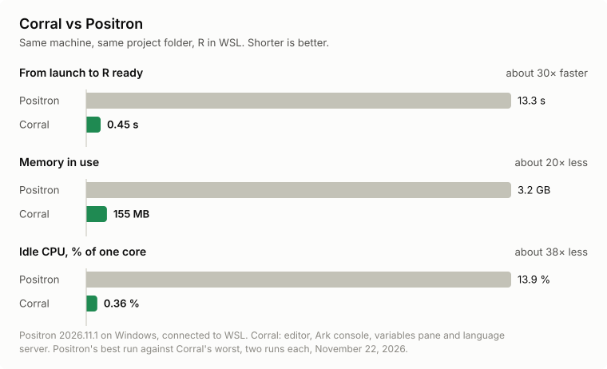

<p align="center"></p>

<h1 align="center">Corral</h1>

<p align="center"><b>An agentic Data Science IDE that opens in milliseconds.</b><br>
An IDE that lives in your terminal, built with modern technology around the data science workflow.<br>
For R and Python: blazing fast with massive data, ready for professional work and ready to run with your agents.<br>
Written in Rust. DuckDB for your data.</p>

<p align="center">
  <a href="https://paulovillarroel.github.io/corral-term/">Website</a> ·
  <a href="https://paulovillarroel.github.io/corral-term/docs/">Documentation</a> ·
  <a href="https://paulovillarroel.github.io/corral-term/docs/install.html">Install</a>
</p>

Corral gives you the everyday loop of a full IDE inside your terminal: write a script and run it piece by piece, keep a live console, and see your variables, tables and plots. It lives in a [herdr](https://herdr.dev/tui/) workspace next to Claude Code or any other agent, and the agent runs code in the same session you are looking at.

- **Script editor.** <kbd>Ctrl</kbd>+<kbd>R</kbd> runs the line or selection, <kbd>F5</kbd> the file. Completion knows your live R objects; Air formats R and Ruff formats Python on save.
- **Live console.** R on [Ark](https://github.com/posit-dev/ark), Positron's R kernel, or plain R. Python in IPython, in your project's uv environment, one key away.
- **Big tables, instantly.** DuckDB is the data engine behind `View()`: Corral queries only what is on screen (a page of rows, a sort, a filter in R or SQL, a summary of each column), so ten million rows show up in about 34 ms and the viewer uses about 3 MB. Tables open in the terminal, or in Mirador, in your browser, when you press `m`. A variables pane updates after every command.
- **Plots that keep up.** Mirador shows each new plot about 80 ms after it is drawn, with history, download and copy as PNG.
- **Agents in your session.** Claude Code, Codex or any other agent runs R or Python in your console with `corral eval` and gets the output back, so its objects land where you can see them. Corral ships a skill in the open [Agent Skills](https://agentskills.io) format that teaches agents how.
- **Close the window, lose nothing.** Consoles live in herdr, so your workspace is exactly where you left it.

## Install

```bash
curl -LsSf https://raw.githubusercontent.com/paulovillarroel/corral-term/main/install.sh | sh
```

The installer checks everything before it changes anything, tells you what to run for whatever is missing, never uses sudo, and backs up every file it touches. It needs Linux x86_64 or Windows with WSL, [herdr](https://herdr.dev/tui/) 0.9.5 or later, and R with the `httpgd` and `jsonlite` packages; it brings the rest (Fresh, DuckDB, Air, Ark). Python is optional, through [uv](https://docs.astral.sh/uv/). macOS is not supported yet. `corral uninstall` takes it all out again. Details: [Install](https://paulovillarroel.github.io/corral-term/docs/install.html).

## Quick start

Open herdr in a project folder, then:

| Keys | What happens |
|---|---|
| <kbd>ctrl+b</kbd> <kbd>a</kbd> | Open the workspace: your agent on the left; the script, the R console and the variables on the right |
| <kbd>ctrl+b</kbd> <kbd>shift+a</kbd> | The same, with the script on the left and the agent over the console |
| <kbd>Ctrl</kbd>+<kbd>R</kbd> / <kbd>F5</kbd> | Run the line or selection / the whole file |
| <kbd>ctrl+b</kbd> <kbd>y</kbd> | Switch the console between R and Python |
| <kbd>ctrl+b</kbd> <kbd>f</kbd> | Show the latest plot in Mirador |
| <kbd>ctrl+b</kbd> <kbd>space</kbd> | Every shortcut, searchable |

## Performance

<picture>
  <source media="(prefers-color-scheme: dark)" srcset="site/assets/charts/vs-positron-dark.svg">
  
</picture>

Measured on the same machine and project, R in WSL, two runs each, against Positron 2026.11.1 as a full desktop IDE. From `corral send` (<kbd>Ctrl</kbd>+<kbd>R</kbd>) to the result on screen takes about 5 ms. Method and per-piece numbers: [Performance](https://paulovillarroel.github.io/corral-term/docs/performance.html).

## How it is built

Corral is one small program, `corral`, written in Rust with no dependencies: the layout, consoles, variables pane, table viewer, palette, Mirador's server and installer are all in it. It drives the pieces that do the heavy lifting, most of them Rust as well: herdr for the workspace, Ark for R, [Fresh](https://getfresh.dev) for the editor, [DuckDB](https://duckdb.org) for tables, and uv, ty and Ruff for Python. The only parts that are not Rust run inside your own sessions: `r/corral.R` in R, `py/` in IPython, and the editor plugin in `fresh/`. The agent skill is in `skills/corral-r`; the installer puts it in `~/.agents/skills` (read by Codex and other agents) and in `~/.claude/skills` for Claude Code. The website and documentation are in `site/`.

To build from a clone:

```bash
git clone https://github.com/paulovillarroel/corral-term.git
sh corral-term/install.sh
```

## Status

Version 0.1.0, in daily use on Windows with WSL. Linux x86_64 and WSL are supported; macOS is not yet.
