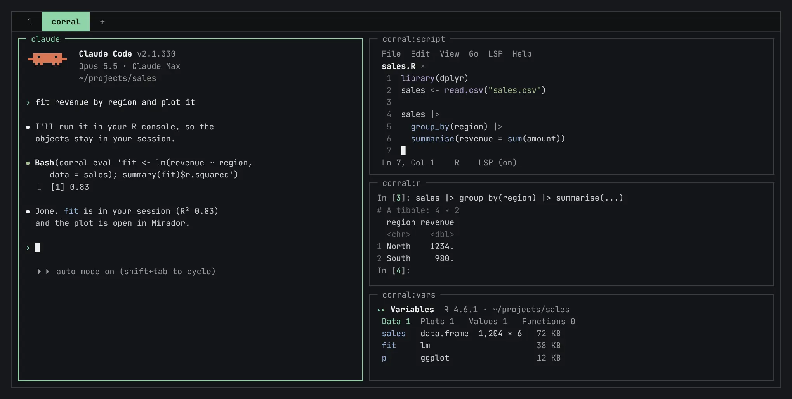
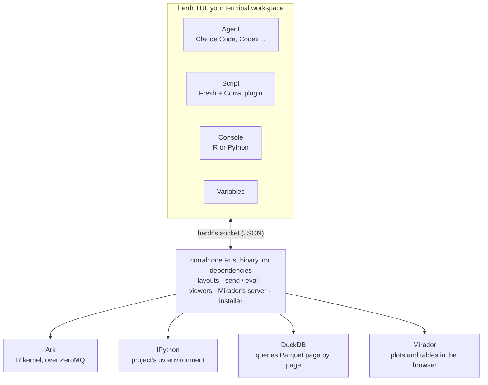

<p align="center"></p>

<h1 align="center">Corral</h1>

<p align="center"><b>An agentic Data Science IDE that opens in milliseconds.</b><br>
A terminal-native data science workspace for R and Python, built for working alongside AI agents:<br>
you and your agent share one live session, under your control.<br>
Written in Rust. DuckDB for your data.</p>

<p align="center">
  <a href="https://corral-term.dev/">Website</a> ·
  <a href="https://corral-term.dev/docs/">Documentation</a> ·
  <a href="https://corral-term.dev/docs/architecture.html">Architecture</a>
</p>

<p align="center"></p>

- **Script, console, variables, tables and plots** in a [herdr TUI](https://herdr.dev/tui/) workspace: R on [Ark](https://github.com/posit-dev/ark), Python in IPython.
- **Big tables at once.** `View()` saves the table as Parquet and asks DuckDB only for what's on screen: ten million rows take about a second to save with nanoparquet, then about 30 ms a screen.
- **Agents in your session.** Corral is the harness between your agent and your live session: the agent runs code in your console with `corral eval`, guided by an [Agent Skills](https://agentskills.io) skill, within rules you set ([the agent harness](https://corral-term.dev/docs/agents.html#the-agent-harness)).
- **Light.** R ready in 0.45 s and 155 MB in use (200 MB counting herdr), against 13.3 s and 3.2 GB for Positron ([how it was measured](https://corral-term.dev/docs/performance.html)).

## Install

### What you need first

| You need | How to get it |
|---|---|
| Linux x86_64, or Windows with WSL | On Windows: `wsl --install` in PowerShell, then do everything inside Ubuntu. macOS is not supported yet. |
| `curl` and `tar` | Ubuntu has them; otherwise `sudo apt install curl tar`. |
| [herdr TUI](https://herdr.dev/tui/) 0.9.5 or newer | herdr's terminal version, not the Herdr App. `herdr update` updates it. |
| R, with the `httpgd` and `jsonlite` packages | R from [CRAN](https://cloud.r-project.org) or [rig](https://github.com/r-lib/rig), then `Rscript -e 'install.packages(c("httpgd", "jsonlite"))'`. |

Optional: an agent (Claude Code, Codex, Gemini CLI, opencode…), [uv](https://docs.astral.sh/uv/) for the Python console, and the R packages `nanoparquet` and `rlang`.

### One line

```bash
curl -LsSf https://corral-term.dev/install.sh | sh
```

The installer downloads the latest published version, says which, and checks its SHA-256 before opening it and, if you have the GitHub CLI, its [build provenance attestation](https://corral-term.dev/docs/install.html#how-the-download-is-checked); it never falls back to unreleased code. It prints a checklist of everything above and, for anything missing, the command that fixes it; if something required is missing it stops without changing anything. Then it:

- puts `corral` (already compiled) in `~/.local/bin`, and downloads what you don't have: [Fresh](https://getfresh.dev), [DuckDB](https://duckdb.org), [Air](https://posit-dev.github.io/air/) and Ark, each checked against a SHA-256 written into Corral's code;
- links Corral's plugin and shortcuts into herdr, one line into `~/.Rprofile` (it only acts in Corral's consoles), Corral's settings into Fresh, and the agent skill into `~/.agents/skills` and `~/.claude/skills`;
- backs up every file it touches (`*.before-corral-DATE`) and never uses `sudo`.

`sh -s -- --check` at the end of the line only checks. `corral uninstall` takes everything out again. At the end it sends one anonymous ping (version, system, country; no IP) to count installs; `CORRAL_NO_TELEMETRY=1` turns it off. Details: [Install](https://corral-term.dev/docs/install.html).

### Then

Open herdr in a project folder and press <kbd>ctrl+b</kbd> <kbd>a</kbd>: your agent, the script, the R console and the variables. <kbd>Ctrl</kbd>+<kbd>R</kbd> runs a line, <kbd>ctrl+b</kbd> <kbd>y</kbd> switches to Python, <kbd>ctrl+b</kbd> <kbd>space</kbd> lists every shortcut. [Quick start](https://corral-term.dev/docs/quickstart.html).

## Performance

<picture>
  <source media="(prefers-color-scheme: dark)" srcset="site/assets/charts/vs-positron-dark.svg">
  
</picture>

Same machine and project, R in WSL, two runs each, against Positron as a full desktop IDE. <kbd>Ctrl</kbd>+<kbd>R</kbd> to the result in your console takes about 5 ms. Method and the numbers for each piece: [Performance](https://corral-term.dev/docs/performance.html).

## How it is built

Corral is a thin layer of Rust between herdr and the engines that do the heavy lifting:



- **Code:** <kbd>Ctrl</kbd>+<kbd>R</kbd> runs `corral send` and agents run `corral eval`; both type into your live console, so you see every line run. After each command the session writes its variables for the variables pane.
- **Tables:** `View(df)` writes a temporary Parquet file and the table viewer asks DuckDB only for the rows on screen; <kbd>m</kbd> opens the same file in Mirador.
- **Plots:** httpgd (or its Python twin) draws them, and Mirador shows each one about 80 ms later.

| Technology | What it does in Corral | Written in |
|---|---|---|
| [herdr TUI](https://herdr.dev/tui/) | The terminal workspace: panes that survive closing the window | Rust |
| `corral` | Layouts, sending code, `corral eval`, variables pane, table viewer, palette, Mirador's server, installer | Rust, no crates |
| [Ark](https://github.com/posit-dev/ark) | R kernel and language server (Positron's) | Rust |
| [Fresh](https://getfresh.dev) | Script editor, with Corral's plugin | Rust (plugin in TypeScript) |
| [DuckDB](https://duckdb.org) | Queries the tables `View()` opens | C++ |
| [httpgd](https://github.com/nx10/httpgd) | R's graphics device that Mirador reads | R / C++ |
| [uv](https://docs.astral.sh/uv/), IPython, [ty](https://github.com/astral-sh/ty), [Ruff](https://docs.astral.sh/ruff/) | The Python console, completion and formatting | Rust / Python |
| [Air](https://posit-dev.github.io/air/) | Formats R on save | Rust |

The repository: `rs/` is `corral`; `r/` and `py/` run inside your R and Python sessions; `fresh/` is the editor plugin; `herdr/` the herdr plugin; `mirador/` Mirador's page; `skills/` the agent skill; `site/` the website and documentation; `api/` the install counter on Vercel. More in [Architecture](https://corral-term.dev/docs/architecture.html).

## Security

Agents run code in your real session, so the user stays in control, and Corral enforces it in its own code rather than in the agent's instructions: `corral config agents ask|on|off` (`ask`, the default, holds every request until you approve it in a popup), `agent_output review` (you see each result first and decide whether the agent gets it) or `structure` (it sees whether it worked and the shape of objects, not values; keep `ask` on with it, since the agent writes the code), all also in the palette, `corral_sensitive()` for one session, and a local audit log (`corral audit`). Corral is not a sandbox, and what an agent reads goes to its model provider: the [Security model](https://corral-term.dev/docs/security.html) explains the limits and a setup for sensitive data.

## Problems and ideas

If something doesn't work, or you have an idea, please [open an issue](https://github.com/paulovillarroel/corral-term/issues). It helps to include `corral --version`, your system (Linux or WSL) and what `corral doctor` prints; for an installation problem, the output of the install line with `sh -s -- --check` at the end.

## Telemetry

For transparency: the installer sends one anonymous ping when an installation finishes, only to measure how many times Corral is installed and from which countries. It carries the version, the system (Linux or WSL), whether it is a new install or an update, and whether it came from the published package or a clone; the country comes from Vercel's geolocation of the request, and the IP address is never stored. It counts installations, not people: installing again or updating counts again. Corral itself sends nothing else, ever. Working with an agent is a separate matter: whatever the agent reads (results, plots, errors) goes to its model provider, with the risks that come with using that agent; the [Security model](https://corral-term.dev/docs/security.html) explains what reaches it and how to limit it. `CORRAL_NO_TELEMETRY=1` (or `DO_NOT_TRACK=1`) turns it off; the code that receives it is [`api/installed.js`](api/installed.js).

---

Version 0.1.7 · Linux and WSL; macOS not yet · [MIT license](LICENSE).
